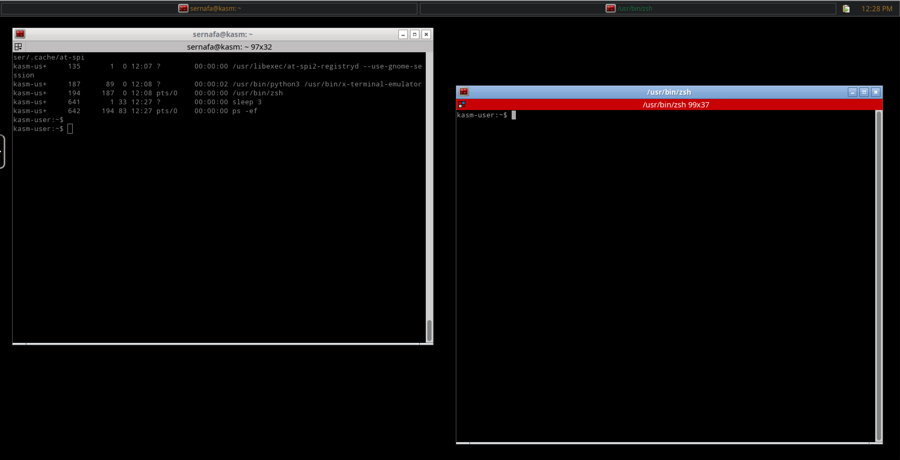

# kasm-openbox-minimal

> **Note:** this project is a fork of [yusiwen/kasm-core-minimal](https://github.com/yusiwen/kasm-core-minimal) and is based on its code, which in turn builds on Kasm Technologies' [workspaces-core-images](https://github.com/kasmtech/workspaces-core-images). All credit for the original work goes to their authors.

A minimal KasmVNC Docker image with a full-featured Openbox desktop: web browser access, clipboard manager, application launcher, terminal and file manager — in a ~900 MB image with no audio, printer, webcam or browser bloat.



## Features

### Desktop

- **Openbox** window manager with a dark **tint2** panel at the top (taskbar, system tray and clock)
- **rofi** launcher using its bundled Arc-Dark theme:
  - `W-w` — window switcher
  - `W-s` — SSH connections
  - `C-space` — run dialog
- **terminator** as the default terminal (`x-terminal-emulator`), with Noto Mono 10; `xterm` kept as a lightweight fallback
- **pcmanfm** file manager and **feh** image viewer
- **xfce4-clipman** clipboard manager, autostarted with the session and integrated with the KasmVNC clipboard
- **elementary-xfce** icon theme so systray icons are visible on the dark panel
- Right-click on the desktop opens the Openbox root menu; applications are also available through obamenu

### Fonts and shell

- **Noto** as the system font: fontconfig prefers Noto Sans / Serif / Mono for the generic families, and terminals use Noto Mono
- **zsh** installed and set as the default shell for `kasm_user` (bash is still available)
- Window titlebars use Noto Sans bold 10 to match the terminal titlebars

### Included software

- KasmVNC server, Python 3.12, D-Bus session
- CLI tools: `vim`, `git`, `mc`, `net-tools`, `iproute2`, `iptables`, `openssh-client`, `dnsutils` (dig/nslookup), `netcat-openbsd`, `bc`, `bzip2`, `wmctrl`, `mesa-utils`, `vulkan-tools`
- Fonts: Noto core and DejaVu core
- What is deliberately **not** included: audio, printer, webcam, NVIDIA, web browser, mail and similar bloat — keeping the image simple and small

## Ports

| Port | Purpose |
|------|---------|
| 6901 | KasmVNC web client (HTTPS by default) |
| 5901 | Native VNC |
| 4902 | Upload server (HTTPS, serves `~/Uploads`) |

## Environment variables

| Variable | Default | Description |
|----------|---------|-------------|
| `VNC_PW` | `vncpassword` | Password of the `kasm_user` user |
| `VNC_VIEW_ONLY_PW` | `vncviewonlypassword` | Password of the read-only `kasm_viewer` user |
| `TZ` | `Europe/Madrid` | Timezone |
| `LC_ALL` | `en_US.UTF-8` | Locale; `es_ES.UTF-8` is also generated and selectable |
| `VNC_RESOLUTION` | `1280x720` | Initial desktop resolution |
| `MAX_FRAME_RATE` | `24` | KasmVNC frame rate |
| `KASM_VNC_SSL` | `1` | Set to `0` to disable SSL on the web/VNC ports |
| `KASM_NO_AUTH` | `1`... unset | Set to `1` to disable basic authentication |
| `KASMVNC_AUTO_RECOVER` | `true` | Restart KasmVNC automatically if it crashes |
| `KASM_NO_VETH` | `0` | Set to `1` when using networks other than bridge (e.g. macvlan) |
| `KASM_SVC_UPLOADS` | `1` | Set to `0` to disable the upload server |

A `/dockerstartup/custom_startup.sh` script is executed after the session if you mount one into the container (it must be executable).

## Build

Use [docker bake](https://docs.docker.com/build/bake/) to build the images (single-arch, `linux/amd64`):

```bash
docker buildx bake --load
```

This builds the default target (`openbox`, standard Ubuntu image) and loads it into the local Docker store. A specific target can be built with:

```bash
docker buildx bake --load openbox-systemd
```

Build and load every variant (standard, systemd, trixie, trixie-systemd) with:

```bash
docker buildx bake --load all
```

Target names are stable across versions. The image name and version come from the `IMAGE` and `VERSION` variables in `docker-bake.hcl` and can be overridden from the environment:

```bash
IMAGE=sernafa/kasm-openbox-minimal VERSION=1.1.0 docker buildx bake --load openbox
```

## Usage

```bash
docker run --rm -p 6901:6901 -e VNC_PW=password ghcr.io/sernafa/kasm-openbox-minimal:1.0.0
```

Access [https://localhost:6901](https://localhost:6901) in a web browser.

The default username is `kasm_user`; the password is set by `$VNC_PW`.

If the container will use a network other than bridge, such as macvlan, it must be started with:

```bash
docker run --rm -p 6901:6901 -e VNC_PW=password -e KASM_NO_VETH=1 ghcr.io/sernafa/kasm-openbox-minimal:1.0.0
```

Keyboard shortcuts of the desktop:

| Keys | Action |
|------|--------|
| `C-space` | rofi run dialog |
| `W-w` | rofi window switcher |
| `W-s` | rofi SSH connections |
| Right click | Openbox root menu |

Uploaded files land in `~/Uploads` and are reachable from the browser through the upload server; downloads are served from `~/Downloads`.

### systemd compatible image

`ghcr.io/sernafa/kasm-openbox-minimal:1.0.0-systemd` runs systemd as the init process, so services inside the container can be managed with `systemctl`. It requires privileged mode and a shared cgroup:

```bash
docker run --rm -d --name kasm-openbox-minimal \
  -e VNC_PW=password -p 6901:6901 \
  --shm-size=512m --privileged \
  -v=/sys/fs/cgroup:/sys/fs/cgroup:rw \
  --ulimit nofile=1048576:1048576 \
  --cgroupns=host --user=root \
  ghcr.io/sernafa/kasm-openbox-minimal:1.0.0-systemd
```

Then:

```bash
docker exec kasm-openbox-minimal systemctl status kasmvnc
```

Note that only the variables listed in `PassEnvironment` of the `kasmvnc.service` unit reach the session (e.g. `TZ` does, `LC_ALL` does not), and `kasm-user` has no sudo in this variant.

## Publishing

Images are published to the GitHub Container Registry (GHCR) by two GitHub Actions workflows:

- **Release** (`.github/workflows/release.yml`) — automatic. Pushing a `v*` tag (e.g. `v1.0.0`) builds the default bake target and publishes `ghcr.io/<owner>/<repo>:<version>` (tag without the `v`).
- **Manual build** (`.github/workflows/manual-build.yml`) — manual `workflow_dispatch`. Pick a bake target (any of the four variants or `all`) and a version tag to publish.

Both workflows set the bake file's `IMAGE`/`VERSION` variables, so each variant is published with the suffix defined in `docker-bake.hcl` (`-systemd`, `-trixie`, `-trixie-systemd`) and they never collide.

## License

[MIT](LICENSE). The Kasm Technologies copyright notice is retained because parts of this code derive from their MIT-licensed [workspaces-core-images](https://github.com/kasmtech/workspaces-core-images). The license applies to the source in this repository only, not to the software installed in the image (Ubuntu packages, KasmVNC, etc.), which keeps its own licenses.

## References

- Fork of [yusiwen/kasm-core-minimal](https://github.com/yusiwen/kasm-core-minimal)
- https://github.com/kasmtech/workspaces-core-images
